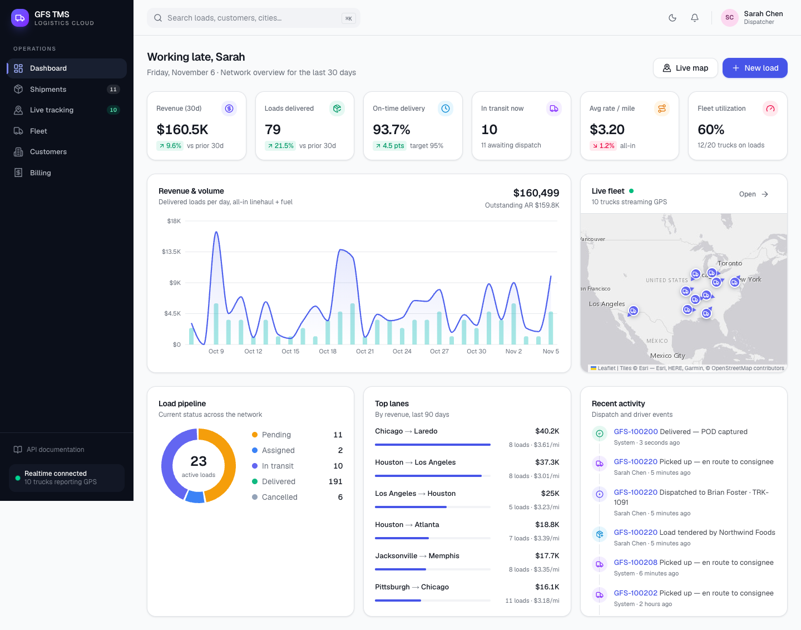
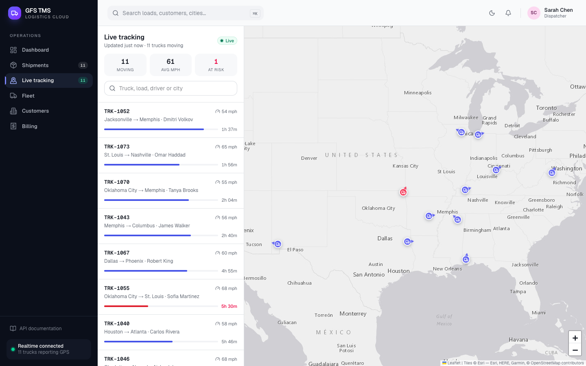
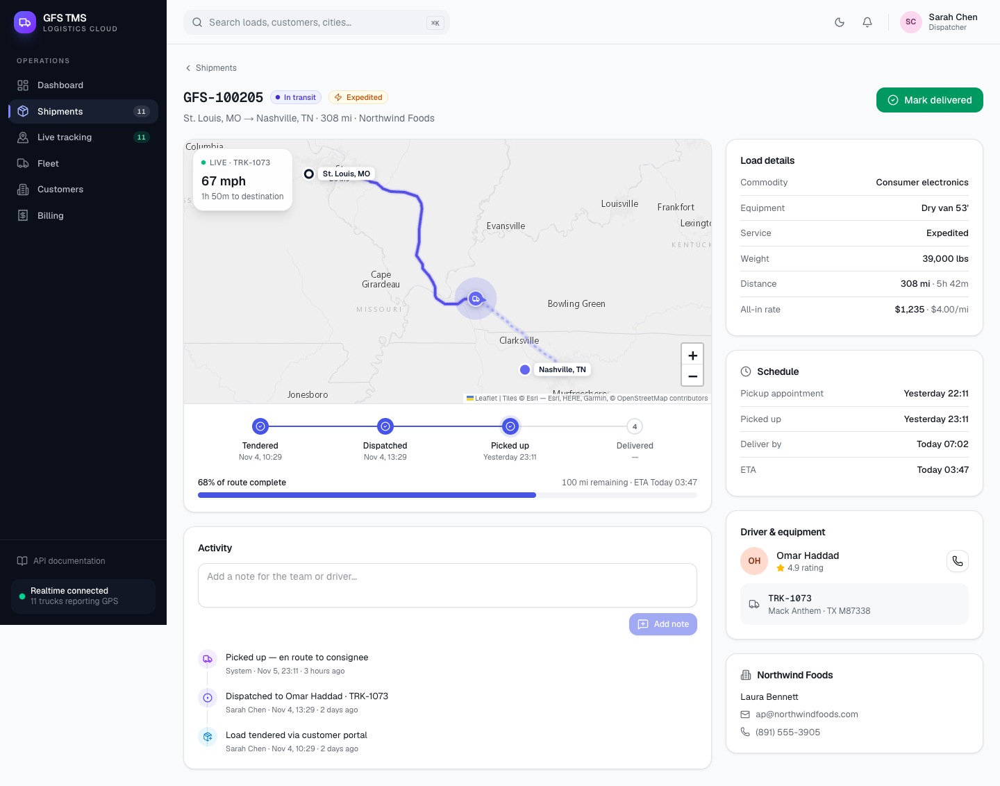
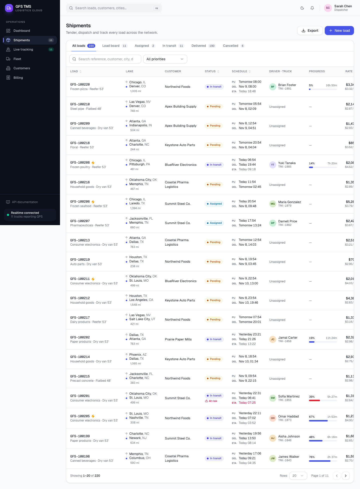
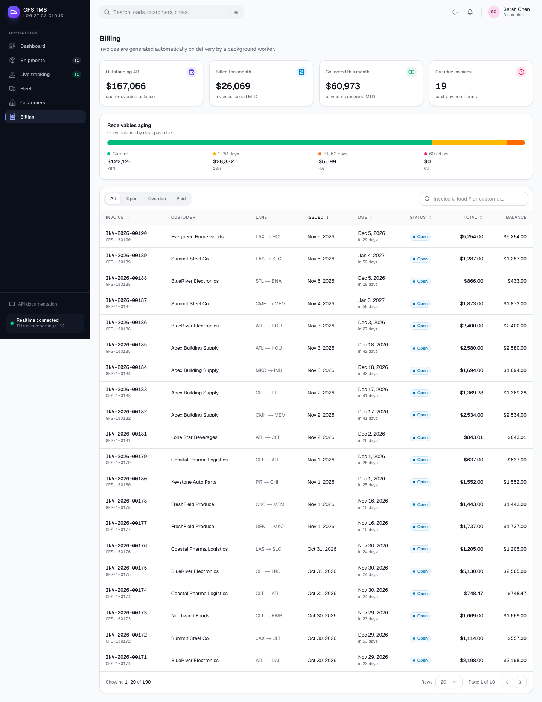
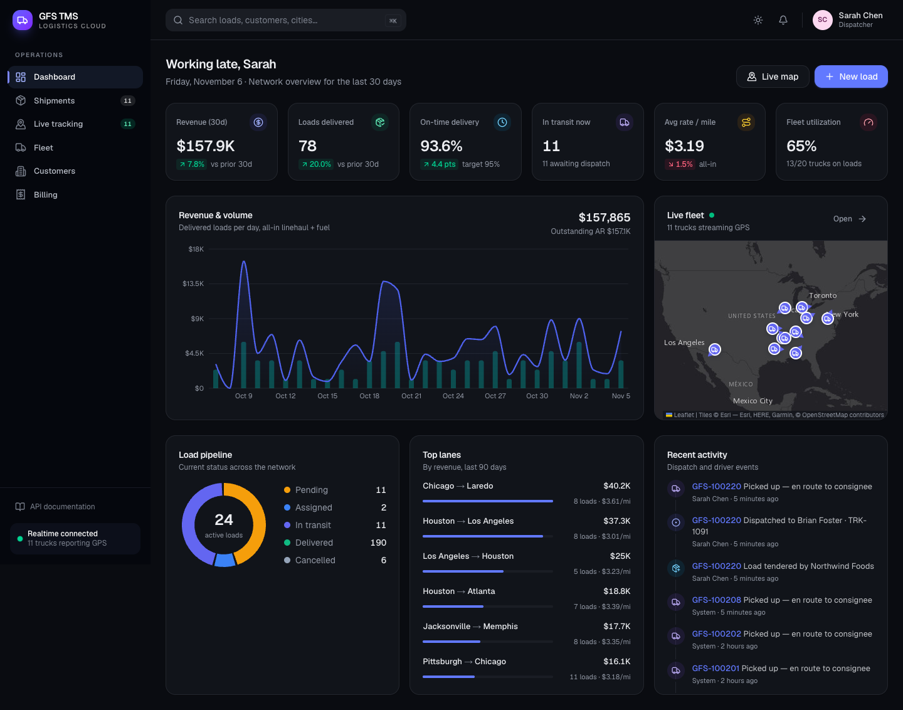
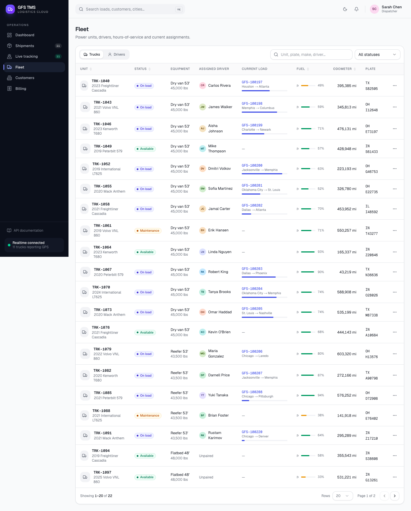
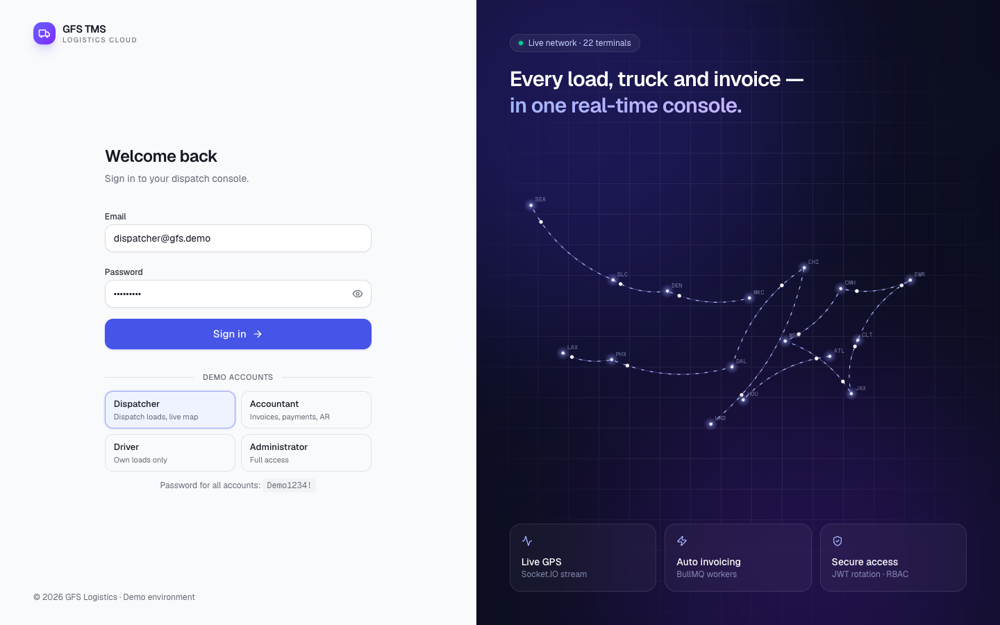
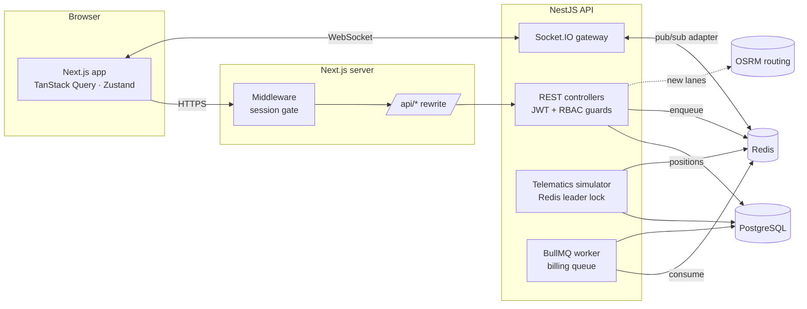

# GFS TMS — Transportation Management System

A full-stack TMS demo for freight logistics: **tender loads, dispatch drivers and trucks, track the fleet live on a map, and bill customers automatically** — built with **Next.js 15 (App Router) + NestJS 11 + PostgreSQL + Redis**.



| Live tracking | Load detail |
| --- | --- |
|  |  |
| **Load board** | **Billing & AR** |
|  |  |

<details>
<summary>More: dark mode, fleet, login</summary>





</details>

---

## Features

**Dispatcher**
- Load board with server-side **pagination, sorting, filtering and search** (TanStack Table), with state kept in the URL
- **Tender a load** using React Hook Form + Zod, with an **instant spot quote** and a **real road route** (OSRM) shown on a map
- **Dispatch dialog** checks equipment compatibility, truck capacity, double-booking and hours of service
- Lifecycle `PENDING → ASSIGNED → IN_TRANSIT → DELIVERED`, with an audit timeline and notes
- **Live tracking**: trucks move along real highways over Socket.IO, with speed, heading, ETA and an at-risk flag

**Accountant**
- An invoice is **generated automatically on delivery** by a BullMQ background worker
- **Idempotent payment recording** (`Idempotency-Key`), partial payments, and over-payment protection
- AR summary with **aging buckets** (current / 1–30 / 31–60 / 60+), plus a repeatable job that marks overdue invoices

**Driver**
- Sees **only their own loads** (enforced by the API, not just the UI) and updates pickup and delivery

**Platform**
- Dashboard: KPIs, 30-day revenue and volume chart, load pipeline, top lanes, activity feed, mini live map
- Real-time notifications (deliveries, invoices), dark mode, responsive layout, ⌘K search
- Swagger / OpenAPI docs at `/api/docs`

## Tech stack

| Layer | Technology |
| --- | --- |
| Frontend | Next.js 15 (App Router), React 19, TypeScript, Tailwind CSS v4, shadcn-style components on Radix UI |
| State & data | TanStack Query (server state), Zustand (session, live fleet, UI), React Hook Form + Zod |
| Tables & charts | TanStack Table (server-driven), Recharts |
| Maps | Leaflet + React-Leaflet, OSRM road routing |
| Backend | NestJS 11, REST + Socket.IO gateway, class-validator, Swagger |
| Data | PostgreSQL 17 + Prisma ORM, Redis (cache, pub/sub, locks) |
| Jobs | BullMQ (invoice generation, overdue sweep) |
| Auth | JWT access token + rotating refresh token (httpOnly cookie), RBAC guards |
| Quality | Jest, React Testing Library, Supertest e2e, GitHub Actions CI, Docker |

## Architecture



### Engineering decisions worth noting

- **Money is integer cents** everywhere (DB, API, calculations). Quotes and invoices split totals so that the parts always add up exactly. Unit tests cover this.
- **Refresh-token rotation with reuse detection.** Refresh tokens are opaque, stored only as SHA-256 hashes, and single-use. Presenting a rotated token revokes the whole token family. The access token lives only in memory, never in `localStorage`.
- **Idempotent payments.** The client sends an `Idempotency-Key` per attempt. Retries replay the original result. A `SELECT … FOR UPDATE` row lock prevents concurrent over-payment, and a unique constraint handles the race between two identical retries.
- **Compare-and-set status transitions.** `UPDATE … WHERE status = <expected>` means the simulator and a user can't both deliver the same load. The allowed transitions are defined in a single state-machine table.
- **Horizontally scalable realtime.** The Socket.IO **Redis adapter** fans out events across API instances. The simulator takes a **Redis leader lock**, so only one instance moves trucks. Invoice jobs use `jobId = invoice-<shipmentId>`, which makes them idempotent.
- **Live UI without refetch storms.** GPS ticks update a Zustand store directly (map markers glide with CSS transitions, progress bars move). Domain events are **coalesced** into one TanStack Query invalidation.
- **Server-driven tables.** Pagination, sorting and filters run in PostgreSQL with indexes. Table state is mirrored in the URL, so views can be shared and survive a reload.

## Getting started

### Option A — Docker (one command)

```bash
docker compose up --build
docker compose exec api pnpm db:seed     # load demo data (first run)
```

Open <http://localhost:3000>.

### Option B — Local development

Requirements: Node 20+, pnpm 10, PostgreSQL 15+, Redis 6+.

```bash
pnpm install
cp apps/api/.env.example apps/api/.env      # set DATABASE_URL / REDIS_URL / JWT secret
cp apps/web/.env.example apps/web/.env.local
pnpm --filter @gfs/api db:migrate           # create schema
pnpm db:seed                                # 90 days of history + live loads
pnpm dev                                    # API :4000 + Web :3000
```

- Web app: <http://localhost:3000>
- API: <http://localhost:4000/api>
- Swagger: <http://localhost:4000/api/docs>

### Demo accounts

Password for every account: **`Demo1234!`** (the login page has one-click buttons for each)

| Email | Role | Can |
| --- | --- | --- |
| `dispatcher@gfs.demo` | Dispatcher | Tender, dispatch, update loads, live map |
| `accountant@gfs.demo` | Accountant | Invoices, payments, AR; read-only operations |
| `driver@gfs.demo` | Driver | Own loads only: pickup / delivery |
| `admin@gfs.demo` | Admin | Everything |

> **Live demo mode:** the API simulates truck GPS along real road geometry (`SIMULATOR_TIME_SCALE=30`, so a 10-hour trip takes about 20 minutes). With `SIMULATOR_AUTOPILOT=true`, assigned loads are picked up automatically and idle crews get new loads, so the map never goes quiet. Pending loads are left for you to dispatch.

## Testing

```bash
pnpm test                          # API unit tests + web component tests
pnpm --filter @gfs/api test:e2e    # Supertest against real Postgres + Redis (uses apps/api/.env.test)
pnpm typecheck
```

| Suite | What it covers |
| --- | --- |
| API unit (Jest) | money math, route interpolation, shipment state machine, RBAC guard, invoice calc, refresh-token rotation and reuse detection |
| API e2e (Supertest) | auth and cookie rotation, validation, RBAC, load board query, **full lifecycle tender → dispatch → pickup → deliver → BullMQ invoice**, double-booking, idempotent payments, AR aging, analytics |
| Web (Jest + RTL) | login form (validation, demo accounts, redirect, API errors), data table (server pagination and sorting), Zod schemas, formatters, badges |

CI (`.github/workflows/ci.yml`) runs install → typecheck → unit tests → e2e with Postgres and Redis service containers → build.

## Project structure

```
gfs-tms/
├── apps/
│   ├── api/                      # NestJS
│   │   ├── prisma/               # schema, migrations, seed, cached OSRM routes
│   │   ├── src/
│   │   │   ├── auth/             # login, refresh rotation, logout, me
│   │   │   ├── shipments/        # load board, lifecycle, quotes, state machine
│   │   │   ├── tracking/         # Socket.IO gateway, GPS simulator, positions store
│   │   │   ├── billing/          # invoices, payments, BullMQ processor
│   │   │   ├── fleet/            # trucks, drivers, availability
│   │   │   ├── analytics/        # dashboard KPIs & series
│   │   │   ├── common/           # guards, decorators, money, geo, routing
│   │   │   └── realtime/         # event facade + Redis IO adapter
│   │   └── test/                 # e2e
│   └── web/                      # Next.js
│       └── src/
│           ├── app/              # routes: login, (app)/dashboard, shipments, tracking, fleet, billing…
│           ├── components/       # ui primitives, data-table, map, shipments, dashboard, billing
│           ├── lib/              # api client, query hooks, stores, schemas, formatters
│           └── __tests__/
├── docker-compose.yml
└── .github/workflows/ci.yml
```

## API overview

| Method | Endpoint | Roles |
| --- | --- | --- |
| `POST` | `/api/auth/login` · `/refresh` · `/logout` | public |
| `GET` | `/api/shipments` (page, pageSize, search, status, priority, sortBy, sortDir) | all (drivers: own loads only) |
| `POST` | `/api/shipments` · `/api/shipments/quote` | dispatcher |
| `POST` | `/api/shipments/:id/assign` | dispatcher |
| `PATCH` | `/api/shipments/:id/status` | dispatcher, driver (own load) |
| `GET` | `/api/tracking/positions` | all |
| `GET` | `/api/fleet/vehicles` · `/drivers` · `/availability` | dispatcher, accountant |
| `GET` | `/api/invoices` · `/summary` · `/:id` | accountant, dispatcher |
| `POST` | `/api/invoices/:id/payments` (`Idempotency-Key` header) | accountant |
| `GET` | `/api/analytics/overview` | dispatcher, accountant |

**Socket.IO events** (connect with `auth: { token }`): `fleet:positions`, `shipment:updated`, `invoice:created`.

## Development workflow

Built with AI-assisted development (Claude Code) for scaffolding, refactoring, test generation and documentation. All generated code was reviewed, typechecked and covered by the unit and e2e suites above.

---

### Qisqacha (o'zbekcha)

**GFS TMS** — transport logistikasini boshqarish tizimining demo loyihasi. Frontend Next.js 15 da, backend NestJS 11 da, ma'lumotlar PostgreSQL va Redis da.

- Dispetcher yuk yaratadi (OSRM orqali haqiqiy yo'l marshruti va darhol narx hisoblanadi), haydovchi va mashinani tayinlaydi, yuklarni **jonli xaritada** kuzatadi (Socket.IO).
- Yuk yetkazilganda invoice **avtomatik** yaratiladi (BullMQ). Buxgalter **idempotent** to'lovlarni kiritadi va debitorlik qarzini muddatlar bo'yicha ko'radi.
- Xavfsizlik: JWT va refresh token rotatsiyasi, RBAC (Admin / Dispatcher / Accountant / Driver).
- Testlar: Jest, React Testing Library, Supertest e2e. CI: GitHub Actions. Docker bilan bitta buyruqda ishga tushadi.

Ishga tushirish: `docker compose up --build`, keyin `docker compose exec api pnpm db:seed`. Kirish uchun `dispatcher@gfs.demo` / `Demo1234!`.
